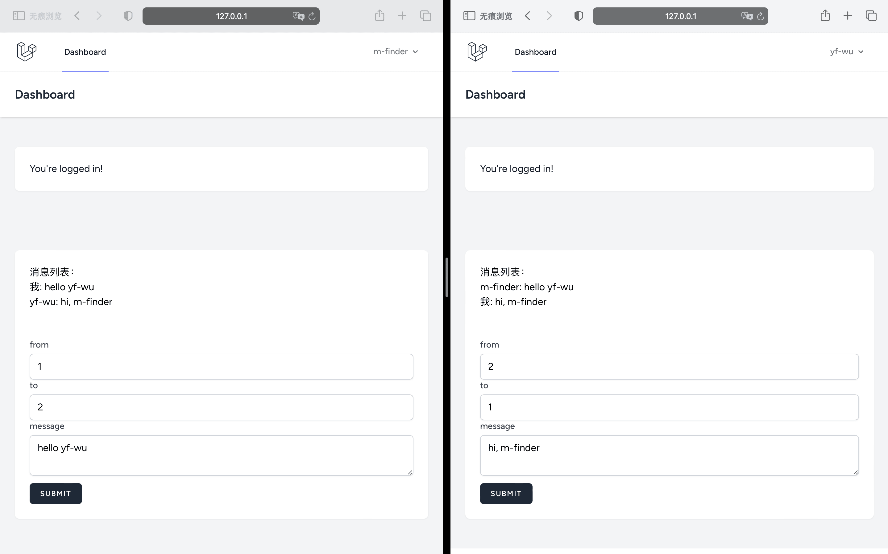

做了一个基于 Swoole 的 WebSocket 扩展包，可以用来做实时状态推送，或者自定义消息处理实现 im，有需要的可以看看: [ [giorgio-socket] ](https://github.com/m-finder/giorgio-socket)


### 使用方法
#### 安装

安装扩展包
```
composer require wu/giorgio-socket
```

发布配置文件
```
php artisan vendor:publish --provider="GiorgioSocket\Providers\SocketServiceProvider"
```

运行 Socket 服务
```
php artisan socket:start
```

### 注意事项
* 可以通过实现 `GiorgioSocket\Services\Handlers\Interfaces` 下的接口类来自定义自己的业务逻辑。
* 如果要从服务端发送消息，这里有两种方式：
    * 第一种，借助 Laravel HTTP 客户端
        ```php
        Route::get('/socket', function () {
            \Illuminate\Support\Facades\Http::asForm()->post('http://127.0.0.1:9501', [
                'to' => 2,
                'message' => 'server message',
            ]);
        });
        ```
    * 第二种：借助 Laravel Listener，需要将 `.env` 文件中的 `QUEUE_CONNECTION` 配置修改为 `redis` 或其他异步队列。配置更改后，运行以下命令：`php-artisan queue:work --queue=socket-listener`监听队列，然后按以下代码调用 `event`：
        ```
        Route::any('socket', function (Request $request){
            \GiorgioSocket\Events\SocketEvent::dispatch($request->get('to'), $request->get('message'));
        });
        ```
* 如果你正在使用 `laravel/breeze` 扩展包，并且使用了 `Blade` 模板，可以将以下代码粘贴到 `dashboard.blade.php` 中进行快速测试：
    ```
      @auth
          <div class="py-12">
              <div class="max-w-7xl mx-auto sm:px-6 lg:px-8">
                  <div class="bg-white dark:bg-gray-800 overflow-hidden shadow-sm sm:rounded-lg">
                      <div class="grid grid-cols-1 md:grid-cols-2">
                          <div class="p-6" id="server-message">
                              messages：<br/>
                          </div>
    
                          <div class="p-6">
                              <label class="block font-medium text-sm text-gray-700 dark:text-gray-300" for="from">from</label>
                              <input class="border-gray-300 dark:border-gray-700 dark:bg-gray-900 dark:text-gray-300 focus:border-indigo-500 dark:focus:border-indigo-600 focus:ring-indigo-500 dark:focus:ring-indigo-600 rounded-md shadow-sm block mt-1 w-full" value="{{ auth()->user()->getKey() }}" id="from">
                              <label class="block font-medium text-sm text-gray-700 dark:text-gray-300" for="to">to</label>
                              <input class="border-gray-300 dark:border-gray-700 dark:bg-gray-900 dark:text-gray-300 focus:border-indigo-500 dark:focus:border-indigo-600 focus:ring-indigo-500 dark:focus:ring-indigo-600 rounded-md shadow-sm block mt-1 w-full" value="" id="to">
                              <label class="block font-medium text-sm text-gray-700 dark:text-gray-300" for="message">message</label>
                              <textarea class="border-gray-300 dark:border-gray-700 dark:bg-gray-900 dark:text-gray-300 focus:border-indigo-500 dark:focus:border-indigo-600 focus:ring-indigo-500 dark:focus:ring-indigo-600 rounded-md shadow-sm block mt-1 w-full" id="message"></textarea>
                              <input class="inline-flex items-center px-4 py-2 bg-gray-800 dark:bg-gray-200 border border-transparent rounded-md font-semibold text-xs text-white dark:text-gray-800 uppercase tracking-widest hover:bg-gray-700 dark:hover:bg-white focus:bg-gray-700 dark:focus:bg-white active:bg-gray-900 dark:active:bg-gray-300 focus:outline-none focus:ring-2 focus:ring-indigo-500 focus:ring-offset-2 dark:focus:ring-offset-gray-800 transition ease-in-out duration-150 mt-3" type="button" id="submit" value="submit">
                          </div>
                      </div>
                  </div>
              </div>
          </div>
          <script type="text/javascript">
            let heartBeatTimer = 0;
            let socket = connectWebSocket();
    
            function startHeartbeat(interval) {
              interval = interval || 30;
              heartBeatTimer = setInterval(function () {
                sendMessage(null, "heart_beat");
              }, interval * 1000);
            }
    
            function stopHeartbeat() {
              clearInterval(heartBeatTimer);
            }
    
            function connectWebSocket() {
              const wsServer = 'ws://127.0.0.1:9501';
              const socket = new WebSocket(wsServer);
    
              let userId = document.getElementById('from').value;
              socket.onopen = function (evt) {
                let data = {
                  user_id: userId,
                  type: 'connect'
                };
                console.log('open', data)
                socket.send(JSON.stringify(data));
              };
    
    
              socket.onmessage = function (evt) {
                console.log('get message from server: ' + evt.data);
    
                if (evt.data !== 'heart_beat') {
                  let data = JSON.parse(evt.data);
                  let message = document.getElementById("server-message")
                  message.innerHTML += data.user_name + ': ' + data.data + '<br/>'
                }
              };
    
              socket.onerror = function (evt) {
                console.log(evt);
              };
    
              socket.onclose = function () {
                let data = {
                  user_id: userId,
                  type: 'close'
                };
                socket.send(JSON.stringify(data));
              };
              return socket;
            }
    
            function sendMessage(to, message) {
              if (socket != null && socket.readyState === WebSocket.OPEN) {
                if (message !== 'heart_beat') {
                  let messageBox = document.getElementById("server-message")
                  messageBox.innerHTML += 'me: ' + message + '<br/>'
                }
                let from = document.getElementById("from")
                socket.send(JSON.stringify({
                  user_id: from.value,
                  user_name: '{{ auth()->user()->name }}',
                  to: to,
                  type: 'message',
                  data: message,
                }));
                console.log("webSocket send message：" + JSON.stringify({
                  user_id: from.value,
                  user_name: '{{ auth()->user()->name }}',
                  to: to,
                  type: 'message',
                  data: message,
                }));
              } else {
                console.log("webSocket closed");
              }
            }
    
            let button = document.getElementById("submit");
            button.addEventListener('click', function () {
              let message = document.getElementById("message");
              let to = document.getElementById("to");
              sendMessage(to.value, message.value)
            });
    
          </script>
      @endauth
  ```
  
  如有任何疑问，欢迎提交 [ [issue] ](https://github.com/m-finder/giorgio-socket/issues)