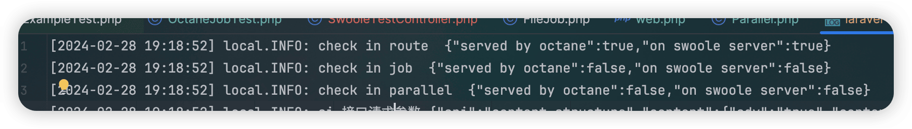
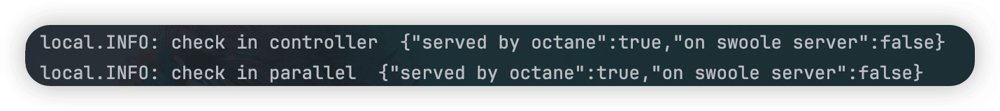

之前在工作中使用 Laravel Octane 的 concurrently 处理并发时，发现在队列和定时任务中不会触发并发效果。经过分析，作了如下猜测：队列定时任务都属于一个独立的进程，与 Octane 服务无关，而 Octane conturrently 恰恰需要在 Octane 环境下才能运行。

后来通过代码进行环境检测和查看 php 的进程，证明猜想成立。
```php
info('check env', [
    'served by octane' => isset($_SERVER['LARAVEL_OCTANE']) && ((int)$_SERVER['LARAVEL_OCTANE'] === 1),
    'on swoole server' => (extension_loaded('swoole') || extension_loaded('openswoole')) && app()->bound(Server::class)
]);
```

为了能够在任意代码中实现并发，我们研究参考了 Hyperf 框架关于协程的代码，然后抽取了如下两个类：
```php
<?php

namespace App\Services;

use App\Exceptions\ParallelExecutionException;
use Laravel\Octane\Facades\Octane;
use Throwable;
use Swoole\Coroutine as Co;

class Parallel
{
    protected array $callbacks = [];
    protected array $results = [];
    /**
     * @var Throwable[]
     */
    protected array $throwables = [];

    public function add(callable $callable, $key = null): void
    {
        if (is_null($key)) {
            $this->callbacks[] = $callable;
        } else {
            $this->callbacks[$key] = $callable;
        }
    }

    public function wait(bool $throw = true): array
    {
        if (isset($_SERVER['LARAVEL_OCTANE']) && ((int)$_SERVER['LARAVEL_OCTANE'] === 1)) {
            return Octane::concurrently($this->callbacks, 300000);
        }

        app('log')->useLoggingLoopDetection(false);
        
        Co\run(function () {
            foreach ($this->callbacks as $key => $callback) {
                Co::create(function () use ($callback, $key) {
                    try {
                        $this->results[$key] = $callback();
                    } catch (Throwable $throwable) {
                        $this->throwables[$key] = $throwable;
                        unset($this->results[$key]);
                    }
                });

            }
        });

        if ($throw && ($throwableCount = count($this->throwables)) > 0) {
            $message = 'Detecting ' . $throwableCount . ' throwable occurred during parallel execution:' . PHP_EOL . $this->formatThrowAbles($this->throwables);
            $executionException = new ParallelExecutionException($message);
            $executionException->setResults($this->results);
            $executionException->setThrowAbles($this->throwables);
            unset($this->results, $this->throwables);
            throw $executionException;
        }

        app('log')->useLoggingLoopDetection(true);
        return $this->results;
    }

    private function formatThrowAbles(array $throwables): string
    {
        $output = '';
        foreach ($throwables as $key => $value) {
            $output .= sprintf('(%s) %s: %s' . PHP_EOL . '%s' . PHP_EOL, $key, get_class($value), $value->getMessage(), $value->getTraceAsString());
        }
        return $output;
    }
}
```


```php
<?php

namespace App\Exceptions;

use RuntimeException;

class ParallelExecutionException extends RuntimeException
{
    protected array $results = [];

    protected array $throwables = [];

    public function getResults(): array
    {
        return $this->results;
    }

    public function setResults(array $results): void
    {
        $this->results = $results;
    }

    public function getThrowAbles(): array
    {
        return $this->throwables;
    }

    public function setThrowAbles(array $throwables): array
    {
        return $this->throwables = $throwables;
    }
}
```

其中，第一个类的作用是检测系统是否运行在 Octane 环境下，是则调用Octane concurrently，否则就执行 Swoole 协程代码，使用起来也比较简单：
```php
$parallel = new Parallel();
$parallel->add(fn() => $this->analysisStructure(), 'structure');
$parallel->add(fn() => $this->analysisHabit(), 'habit');
[
    'structure' => $structure,
    'habit' => $habit,
] = $parallel->wait();
```

之所以没有完全使用 Swoole 协程，是因为相比之下，Octane 代码更加优雅，我们在期待着某天更新后，Octane concurrently 也能直接在队列中运行使用。

第二个类的作用比较简单，就是对协程中异常的一个定义。

另外在分析过程中，我们也发现了一个比较有意思的事情：




 如图所示，当我在路由中运行检测代码时，Octane 和 Swoole server 都为 true；在控制器中运行检测代码时，又只有 Octane 为true；为什么会有这样的区分？我个人猜测是 Octane 在将框架代码读进内存时，特意跳过了控制器中的代码，以避免数据更新不及时等问题。
 
 有知道具体原因的小伙伴，欢迎留言探讨。