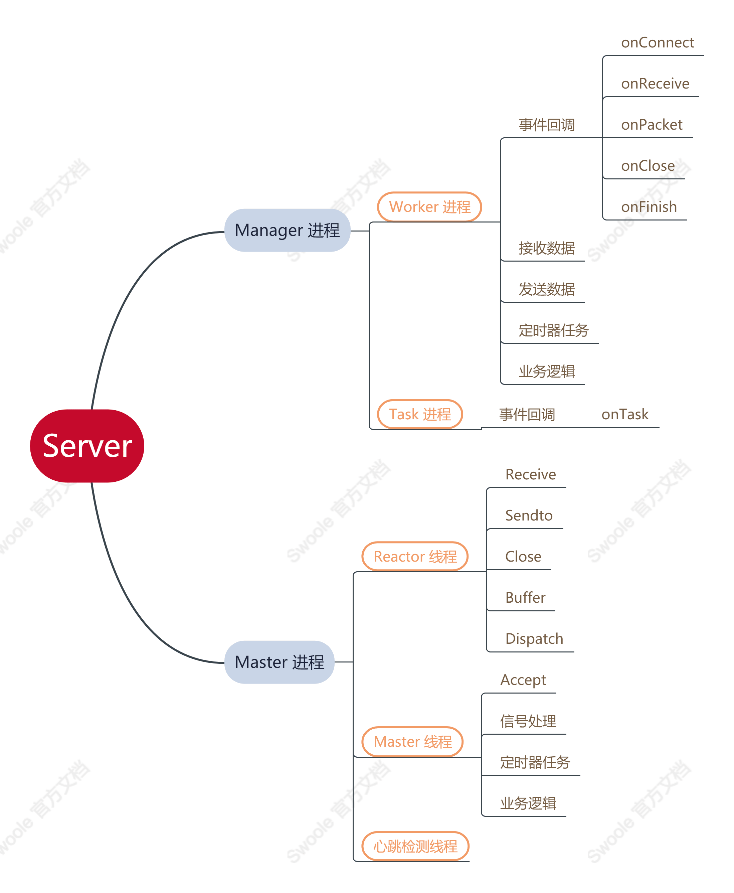

又仔细研究了下 Octane 源码和 Swoole 的文档，关于前几天 Laravel Octane 和 Swoole 协程的使用分析中的猜想，得到进一步验证：

Swoole 的 HTTP Server 启动后会创建一个 master 进程和一个 manager 进程；master 进程又会创建多个 reactor 线程，负责将请求转发到 work，并从 work 接收结果发送给客户端，相当于 nginx；manager 会创建多个 work 和 task 子进程，work 进程相当于 php-fpm，task 专门处理一些耗时任务，最后将结果交给 work；

而 LaravelOctane 的 concurrently 方法，其实是以 task 为基础，也就解释了为什么脱离 HTTP server 会无法使用。

[Swoole](https://wiki.swoole.com/#/learn?id=diff-process)