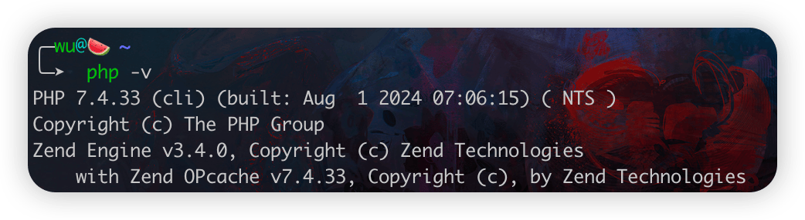

最近又用到 php7.4，奈何本地早就已经升到了 8，想搞回来，发现一个简单好用爽歪歪的三方库，需要的可以试一下，5.6 - 8.4 都有。[[ homebrew-php ] ](https://github.com/shivammathur/homebrew-php)

# 添加地址库
```
brew tap shivammathur/php
```

# 安装指定版本
```
brew install shivammathur/php/php@7.4
```

# 切换版本
```
brew services stop php@7.4
brew unlink php@xx

brew link php@7.4
brew services start php@7.4
```

搞定收工。

