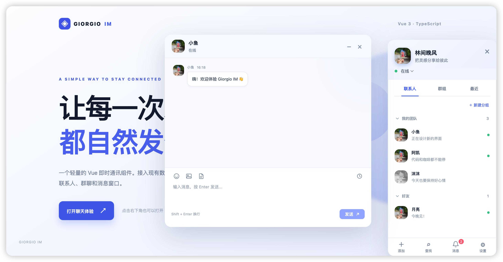

2016 年，因工作需要接触到了 Layui，它的 Layim 让我眼前一亮，感觉可玩性很高。

我参照论坛里大神给出的 .Net 版本搓出一个 PHP 版的后端接口，但因能力有限，只接入了部分功能做演示。

后来服务器到期，我改用融云的测试 API 又搓了一版，但也只停留在演示阶段。

多次想做，但又不停搁置，做一个完整接入的 Layim 似乎成了我求而不得的事情。

22 年，Vue 和 React 早已成为前端主流，我搞了一个把 Layim 做成 Vue 组件的举动，也抽了一个给 Laravel 框架提供 Socket的扩展包，但因种种因素，项目做了一半被搁置至今。

鉴于今年已经成为我编程生涯的 AI 元年，这个尘封的项目被我想了起来，当我拿起鞭子猛抽 Codex，我得到了它：



现在它包括前端组件 * 1，配套的后端扩展 * 1，配套的底层 Socket 扩展 * 1，快速安装脚本 * 1，以及各平台快速体验包的可执行文件 * n;

我把打包好的二进制文件在 Nas 启动，然后让老登用 Tailscale 连了过来，当我在好友列表里看到他的时候，我就知道这玩意儿成了。


## 从一个聊天窗口开始

最先处理的是前端。Giorgio IM 用 Vue 3 和 TypeScript 编写，既可以通过 `createIM()` 直接挂到页面上，也可以作为 `ImWidget` 组件放进现有 Vue 应用。

联系人、好友分组、群聊、消息、未读数、通知逐步有了各自的操作入口。

随后又补上了几种实际项目里会用到的场景：AI 联系人与流式 Markdown 回复、只显示一个会话的客服模式、好友申请与黑名单、群成员管理、附件上传回调、中英文界面和自定义工具栏。

语音和通话也留有接入点，但目前还需要由应用自己提供。

demo 中的 AI 回复和普通聊天自动回复是本地模拟的，方便展示交互。

真正接入时，消息要发给自己的后端，前端包也提供可选的本地加密备份，但它不能代替服务端消息存储。

## 为什么拆成三个包

一个聊天界面容易展示，真正接入已有系统时，用户认证、消息入库、上传、在线连接和断线补收都需要有人负责。

我把这条链路拆成三层：

```text
Vue 页面：@m-finder/giorgio-im
    ↓ HTTP API / WebSocket
Laravel IM 业务：wu/giorgio-im-socket
    ↓
WebSocket 服务：wu/giorgio-socket
```

这样前端组件可以单独接自己的消息服务，Laravel 项目可以直接安装 IM 后端，而底层 Socket 服务也可以用于其他实时推送场景。

### 1. Giorgio IM：前端组件

[源码与使用说明](https://github.com/m-finder/giorgio-im)

这是 Vue 3 + TypeScript 包，提供联系人、好友、群聊、消息窗口、AI 对话和客服模式。

初始化数据和发送消息由接入方提供，组件负责界面及交互。接入配套后端时，可以使用 `createConnectedIM()`，由它处理 Socket 票据、连接、事件补取和重连。

```ts
import { createIM } from '@m-finder/giorgio-im'

const im = createIM({
  init: { user: { id: 'me', username: '我' }, friend: [], group: [] },
  onSendMessage(payload) {
    console.log(payload)
  },
})

im.open()
```

前端包发布在 GitHub Packages，即使包公开，安装时也需要按仓库 README 配置 registry，并使用具有 `read:packages` 权限的 GitHub classic PAT。

### 2. Giorgio IM Socket：Laravel IM 后端

[源码与使用说明](https://github.com/m-finder/giorgio-im-socket) · Composer 包：`wu/giorgio-im-socket`

这层负责 IM 业务：好友申请与分组、黑名单、群成员与禁言、历史消息、发送和已读回执、上传、通知以及 Socket 连接票据。

它接入现有 Laravel 用户模型和认证中间件，不要求项目一定使用 Sanctum。

安装它时，Composer 会同时安装底层的 `wu/giorgio-socket`。

后端把消息和事件持久化，再通知在线用户。

掉线后，客户端可以从最后处理的事件游标继续补收，而不只依赖断线期间是否在线。

### 3. Giorgio Socket：底层 WebSocket 服务

[源码与使用说明](https://github.com/m-finder/giorgio-socket) · Composer 包：`wu/giorgio-socket`

这个包负责连接鉴权、心跳、推送和持久事件。

它支持 Swoole 与 PHP 原生驱动，没有 Swoole 时，本地演示也能用原生驱动运行。

业务消息仍由 Laravel API 处理，Socket 主要负责把事件送到在线连接，或按游标补收遗漏的事件。

它是三层里最通用的一层，除了 IM，也可以用在需要实时通知的 Laravel 应用中。

## 把三个包跑起来

这几天还做了一份本地安装脚本，放在 `giorgio-im-socket` 仓库。

它会准备 Laravel 演示项目、SQLite、前后端依赖、演示页面和配置。

运行前需要 PHP 8.1+、Composer、Node.js/npm 和 Redis，安装前端包时会询问 GitHub classic PAT，输入不会写进项目文件。

```bash
curl -fsSL https://raw.githubusercontent.com/m-finder/giorgio-im-socket/main/tools/setup.sh -o /tmp/giorgio-im-setup.sh
bash /tmp/giorgio-im-setup.sh
```

完成后在项目目录分别启动 Redis、Socket、事件服务和 Laravel：

```bash
redis-server --bind 127.0.0.1 --port 16380 --save '' --appendonly no
php artisan socket:start
php artisan socket:events
php artisan serve --host=127.0.0.1 --port=8001 --no-reload
```

打开 `http://127.0.0.1:8001/im`，用两个账号就能测试真正经过后端的私聊和群聊。端口和具体启动命令以安装脚本的输出为准。

如果只想先看组件界面，不需要本地安装，可以打开 [在线 demo](http://im.m-finder.top/)。这个静态站展示前端交互，聊天和 AI 回复是模拟数据，与上面的完整本地演示不是一回事。

## 发布 demo 踩的坑

为了方便试玩，我新建了 `giorgio-im-docs` 仓库托管静态 demo。第一次部署时，构建虽然成功，GitHub Pages 实际还在从 `main` 根目录发布，于是域名展示的是仓库 README，而不是本地运行时看到的页面。

后来把构建产物写回仓库根目录，并关闭 Jekyll，域名才显示真正的组件 demo。这件事提醒我：CI 显示成功，只能证明工作流跑完；交付网页时，还是要亲自打开域名，检查 HTML 和静态资源。

## AI 在这次开发里的位置

Codex 帮我加快了很多重复工作：搭第一版组件、补类型、连接前后端接口、整理安装脚本和修复边界问题。

但每次推进都需要把需求拆小，明确什么行为必须保留，再验证类型检查、测试和实际运行结果。

从 2016 年第一次用 Layim，到 2022 年搁置的 Vue 版，再到现在整理成三个包，拖了很久的想法终于能运行、能安装、也能拿给别人玩了。

后面还会继续打磨，至少这次它不再只躺在待办清单里。
