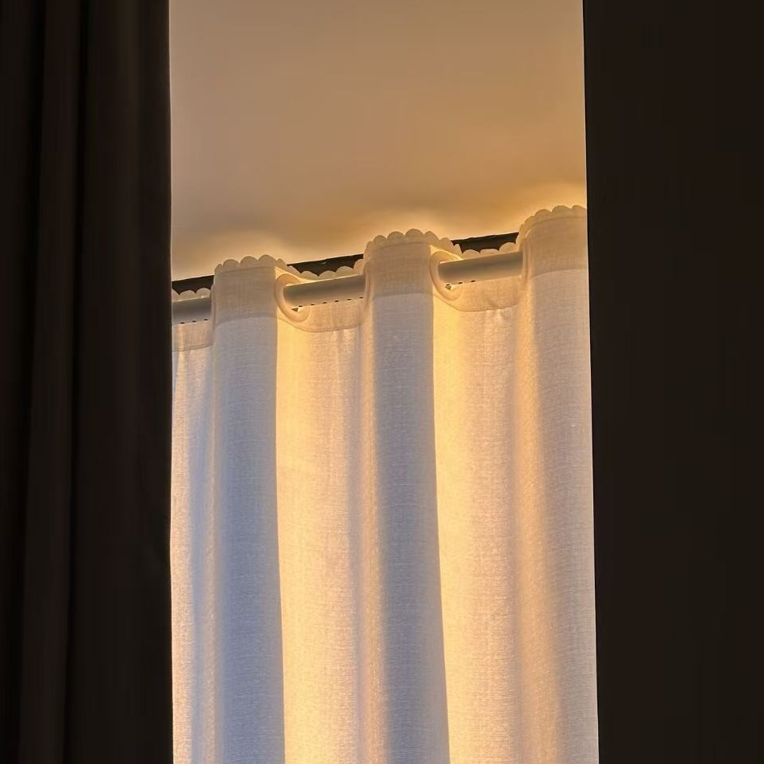

##### 一

最近轮番降温，最低温早已降到个位，正式供暖也已经到了第 4 天。

但这两天是少有的蓝天白云。

每天早上睁开眼，都能看到一缕照到床边的红霞。

暖洋洋的橘红色，像开了一盏氛围灯。

看完心情都好了起来。

就是风有点大。

窗外的杨林都被吹秃了，这一年又到了尾声。

##### 二

每天中午，我都会跟同事一起走路 2 公里，轮番宠幸几家被精心挑选的小饭馆。

今天刚到楼下，我正眯着眼感受阳光。

同事突然问了一句，穿秋裤了吗？

我才突然反应过来，啊，似乎，确实可以穿了。

可是还没下雪。

不想穿。

过几天再说吧。

##### 三

家门口的小饭馆开了关，关了开，已经换了好几轮。

比较稳的有一家羊肉汤，每次从门口路过都能闻到一股热气腾腾的香气。

特别是冬天的早上，香味勾起馋虫，再往店里一看：

窗口正坐着几个人，小口喝着汤，吃着刚打的饼……

可真是诱人啊。

很难不走进去啊。

可是我进去喝了一次，实在是没有在外边闻到的那个味道。

想不明白，我也就不再去了。

旁边一家是个集烧烤、火锅鸡、干锅鸭于一体的综合店，两层。

价格便宜，用料也很实惠。

我带着朋友去了很多次，但只能趁寒暑假期间，经常满到没地方坐。

最后一家，是个小面馆，杂酱干拌是我的最爱。

店主夫妻看着很本分，每次过去都很热情地打招呼。

虽然单品价格略高，但基本都是熟客。

哦，我也是熟客之一吧。

即便我总是吃完就跑，不怎么跟他们聊天。

