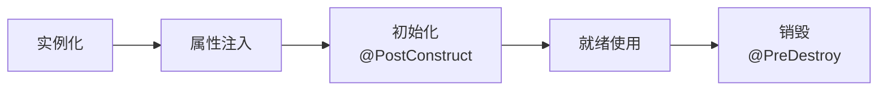
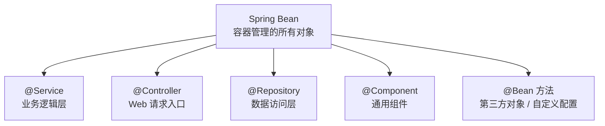
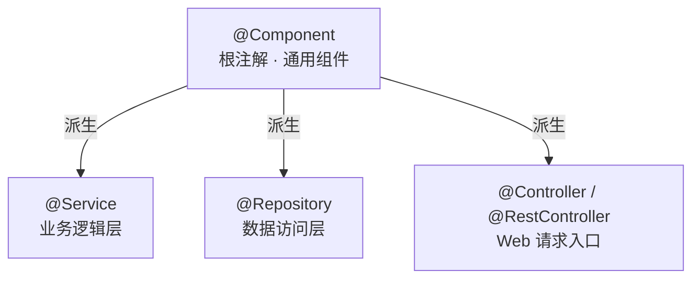
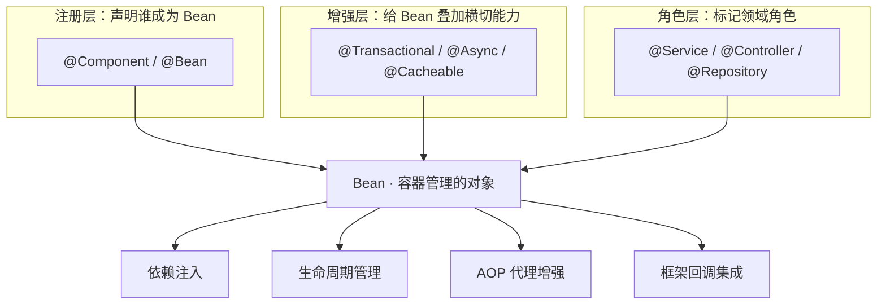

上一篇分析 `Autowired` 和 `Resource` 的区别时提到了一个概念，也就是他们俩都是用来注入 `Bean` 的，那么什么是 `Bean` ？和常见的 `Service`、`Component` 和 `Controller` 等注解又有什么关系呢？

## 一、Bean

### 1.1 什么是 Bean

**Bean 是由 Spring IoC 容器创建、组装并管理生命周期的对象。**

它不是一个特殊的类，而是一种身份——只要对象交给了 Spring 容器管理，它就是 Bean。两者的区别不在对象本身，而在"谁负责创建和销毁它"。

```java
// 传统方式：对象由你的代码创建、组装、销毁
var service = new UserService();
var dao = new UserDao();
service.setDao(dao);

// Spring 方式：声明后由容器接管
@Bean
UserService service(UserDao dao) {
    // 依赖由容器注入
    return new UserService(dao);
}
```

### 1.2 IoC 与 DI

- **IoC（控制反转）**：创建对象的控制权从你的代码转移到容器。你不再写 `new`，而是声明"我需要什么"。
- **DI（依赖注入）**：容器把依赖对象自动送进来。IoC 是思想，DI 是它的具体实现。

### 1.3 Bean 从哪里来

| 方式 | 适用场景 |
|------|---------|
| `@Component` / `@Service` / `@Repository` / `@Controller` | 自己写的类，组件扫描时自动注册 |
| `@Bean` 注解方法 | 第三方库的类，或需要自定义构造逻辑 |
| XML `<bean>` | 遗留项目 |

### 1.4 Bean 的生命周期

容器接管了对象从创建到销毁的全过程：



这一点有实际价值：线程池等资源对象声明为 Bean 后，`initialize()` 由容器在初始化阶段自动调用，应用关闭时也会按序销毁——这就是优雅停机的基础。

---

## 二、Bean 与 Service：不是同一个维度

### 2.1 核心区别

| 维度 | Bean | Service |
|------|------|---------|
| 回答的问题 | 对象**归谁管** | 对象**负责什么** |
| 本质 | Spring 容器管理的对象，是一种身份 | 分层架构中业务逻辑层的组件，是一种角色 |
| 所属体系 | IoC 容器的概念 | 三层/多层架构模式的概念 |
| 关系 | 大概念 | Service 一定是 Bean，Bean 不一定是 Service |

### 2.2 包含关系



以线程池配置为例，可以直观看到两种身份的差别：

```java
// 是 Bean，但不是 Service
@Bean("bizExecutor")
public ThreadPoolTaskExecutor bizExecutor() { ... }

// 既是 Bean，也是 Service
@Service
public class OrderService {
    @Resource private ThreadPoolTaskExecutor bizExecutor;
}
```

---

## 三、Component 与 Service：功能等价，语义有别

### 3.1 源码关系

`@Service` 的源码上标注了 `@Component`，也就是说它是 `@Component` 的特化：



### 3.2 逐项对比

| 维度 | @Component | @Service |
|------|-----------|----------|
| 源码关系 | 根注解 | 标注了 `@Component`，是其特化 |
| 组件扫描 | 会被扫描注册为 Bean | 同样会被扫描注册为 Bean |
| 语义 | 通用组件，无特定含义 | 明确表示"业务逻辑层" |
| 框架附加行为 | 无 | 无 |
| 典型用途 | 工具类、配置类、无法归类的组件 | Service 层的业务服务类 |

**关键事实**：就这两个注解而言，Spring 对它们的处理**完全一样**——没有功能增强、没有生命周期差异、没有注入行为差异。把 `@Service` 换成 `@Component`，程序运行效果完全相同。

### 3.3 既然等价，为什么还要区分

价值全在语义表达和工程约定上：

1. **可读性**：看到 `@Service` 立刻知道这是业务层入口；看到 `@Component` 知道这是通用组件，不承载业务流程。
2. **架构约束**：团队可以约定"Controller 只能依赖 Service，Service 才能依赖 Repository"，通过注解快速识别层级，防止分层被破坏。
3. **AOP 切点**：虽然 `@Service` 本身无增强，但项目中常以它作为切点表达式，统一给业务层加事务、日志或权限拦截。

### 3.4 使用建议

```java
// 业务逻辑层：编排流程、调用多个 Repository
@Service
public class OrderService {
    public OrderVO create(OrderCmd cmd) { ... }
}

// 通用组件：不属于任何业务分层
@Component
public class SnowflakeIdWorker {
    public long nextId() { ... }
}

// 第三方库对象：无法修改源码加注解
@Bean
public ThreadPoolTaskExecutor bizExecutor() { ... }
```

**判断规则**：这个类是业务层服务吗？是 → `@Service`；不是但需由 Spring 管理 → `@Component`；外部类需纳入容器 → `@Bean` 方法。

### 3.5 与另外两个注解的对照

- **`@Repository`**：有真实增强——持久化异常自动转换为 `DataAccessException` 体系。
- **`@Controller` / `@RestController`**：有真实增强——被 Spring MVC 识别并处理请求映射。
- **`@Service` / `@Component`**：都没有框架级增强，纯粹靠语义区分。

---

## 四、建立完整的理解框架

### 4.1 注解的三层作用

前面讨论过的所有注解，可以归到三个层次：



- **注册层**：把对象交给容器，成为 Bean（`@Component`、`@Bean`）。
- **增强层**：给 Bean 叠加能力（`@Transactional` 事务、`@Async` 异步、`@Cacheable` 缓存、`@Validated` 校验）。
- **角色层**：标记领域角色并接入框架机制（`@Controller` 接 MVC、`@Repository` 接数据访问异常体系）。

### 4.2 容器的价值不止于注入

一种常见的理解是"这些注解最终都是为了注入使用"。这个说法**过于狭窄**。反例很直接：

- `@Controller` 的方法由 Spring MVC **直接回调**处理 HTTP 请求，它不需要被注入到别处；
- `@Scheduled` 定时任务由调度器**直接触发**；
- `@EventListener` 由事件机制**直接推送**消息。

这些 Bean 的价值在于"容器在恰当时机调用我"，而非"被别人注入"。

## 五、实践建议与记忆方法

### 5.1 注解选择速查

| 场景 | 推荐注解 |
|------|---------|
| 业务逻辑服务类 | `@Service` |
| Web 请求入口 | `@Controller` / `@RestController` |
| 数据访问层 | `@Repository` / `@Mapper` |
| 工具类、通用组件 | `@Component` |
| 第三方库对象、需自定义构造 | `@Bean` 方法 |
| 声明式事务 | `@Transactional` |
| 异步执行 | `@Async` |

### 5.2 记忆方法

> **Bean 是"户口"**——是否在 Spring 容器登记，决定对象能否被注入、被管理生命周期。
>
> **Service 是"职业"**——在分层架构中承担什么职责，决定这个对象该放在哪一层。
>
> 一个人有户口不代表是老师；有教师资格证的人一定有户口。两个维度互不替代。

### 5.3 回到工程场景

`ThreadPoolTaskExecutor` 就是这套体系的典型应用：

```java
// 注册层：声明为 Bean
@Bean("bizExecutor")
public ThreadPoolTaskExecutor bizExecutor() {
    ThreadPoolTaskExecutor executor = new ThreadPoolTaskExecutor();
    // 有界队列，避免 maxPoolSize 失效
    executor.setQueueCapacity(200);
    executor.setThreadNamePrefix("biz-async-");
    executor.initialize();
    return executor;
}

@Service
public class ReportService {
    @Async("bizExecutor")                  // 增强层：叠加异步能力
    public void generateReport(Long id) { ... }
}
```

一个 Bean，同时承载了**注册声明**（`@Bean`）、**能力增强**（`@Async`）和**角色标记**（`@Service`）三个维度的信息。理解注解体系，本质就是理解这三件事如何组合。

---

## 结语

Bean 回答"归谁管"，Service/Controller 回答"负责什么"，`@Transactional`/`@Async` 回答"叠加什么能力"。

把这三个问题分开问，注解体系就不再是一堆需要死记硬背的符号，而是一套有清晰分工的协作机制。