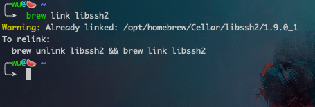

项目里用到了 sftp，所以需要安装一下 ssh2。

安装过程有个报错，开始还以为是不兼容 m1，好在最后顺利安装。

记录一下，以免再次跳坑。

#### 安装 ssh
```shell
pech install ssh2-1.3
```

安装过程中会询问 libssh2 的路径，默认会自动检测，然后，我的问题就来了：
> The required libssh2 library was not found

首先排除一下 libssh2 有没有安装，没有安装的话执行 `brew install libssh2`，然后执行 `brew link libssh2` 查看其路径信息。



接下来，重新执行 `pecl install ssh2-1.3`，命令行询问路径时，将 `/opt/homebrew/Cellar/libssh2/1.9.0_1` 敲入回车即可。

