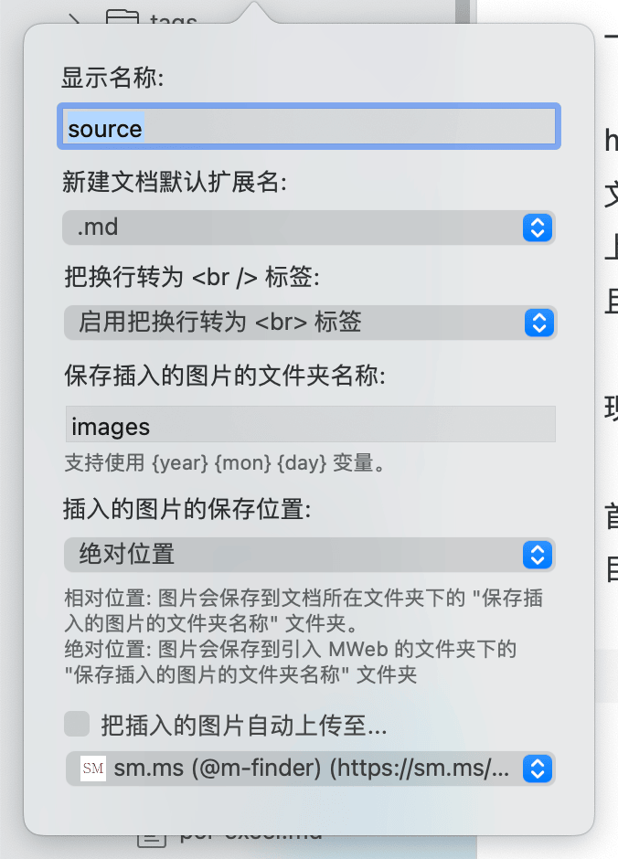

hexo 借助图片插件可以在 post 目录建立跟文章文件的同名文件夹来保存图片，之前也一直都是这么做的，但是在 mweb 上预览时图片不显示，经过一番折腾，反正总会有一番折腾，而且也少不了一番折腾以后，弄好了。

现在将折腾的经过记下来留档。

首先，用 mweb 的外部模式打开 hexo 下的 source 目录，然后右键目录，选择编辑，具体配置如下图，如果没有配置图床可以不用理它，我配完也没理它，为啥呢，因为慢。



把 hexo 的配置文件中：`post_asset_folder` 改为 `false`。

下一步，把你花花哨哨的图片放到 source/images 目录即可，新增图片时用 mweb 的图片工具添加，会自动保存到文件夹内，并且会自动添加 mackdown 格式的图片到文档内。

然后，就没了。

哦，可能需要执行一下这个：
```shell
npm install hexo-asset-image --save
```

这次真的没了。

