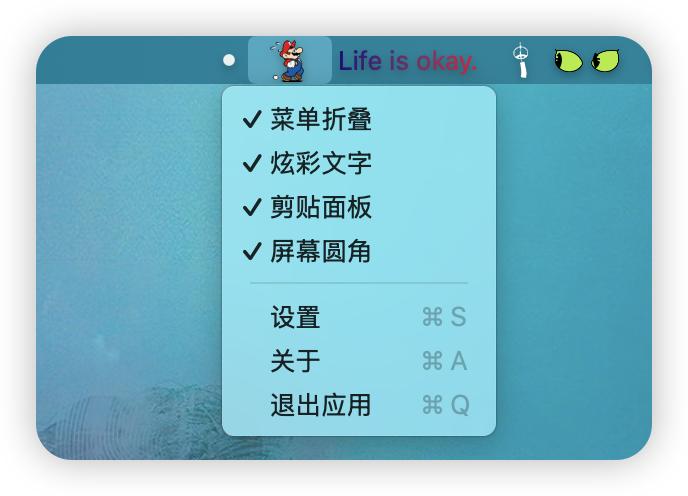

## FancyTool

FancyTool 是一款使用 Swift 原生开发的 macOS 菜单栏工具，包含动态图标、炫彩签名、屏幕圆角、剪切面板、截图工具和只在 macOS 17 以下提供的菜单折叠。
项目源于我有让菜单栏花里胡哨保持骚气的需求，但又不想同时启动太多小软件，所以自己搓了一个能满足我癖好的 App。

- [下载 FancyTool（GitHub Releases）](https://github.com/m-finder/FancyTool/releases)
- 
- 

## Giorgio IM

Giorgio IM 是一套 Vue 3 + TypeScript 即时通讯组件及 Laravel 实时通讯方案。
> 另有 React 方案也已上线，欢迎体验。

前端支持联系人、好友、群聊、AI 对话和客服模式；
Laravel 后端处理消息、认证和管理接口，底层 WebSocket 服务负责推送及断线补收。
在线 demo 使用模拟消息，完整链路可按后端仓库说明在本地运行。

- [在线演示](http://im.m-finder.top/)
- [前端组件：Giorgio IM](https://github.com/m-finder/giorgio-im)
- [Laravel 后端：Giorgio IM Socket](https://github.com/m-finder/giorgio-im-socket)
- [WebSocket 服务：Giorgio Socket](https://github.com/m-finder/giorgio-socket)

## easy-verify-dy

easy-verify-dy 是面向 Laravel 项目的抖音团购核销接口模块，通过 Composer 安装，方便在业务系统中接入抖音团购相关功能。
模块涵盖 client-token 获取、二维码短链解析、验券准备、验券与撤销核销，支持券状态批量查询、订单查询和门店信息查询，也包含售后单查询、退款申请及审批等接口。
适合需要接入抖音团购券核销和售后流程的项目，仓库内提供了配置方式与各接口的调用示例，便于查阅和集成。
如需订制开发或拓展其他平台，可联系 [ email ](mailto:yf-wu@qq.com)

- [源码与使用说明（GitHub）](https://github.com/m-finder/easy-verify-dy)
